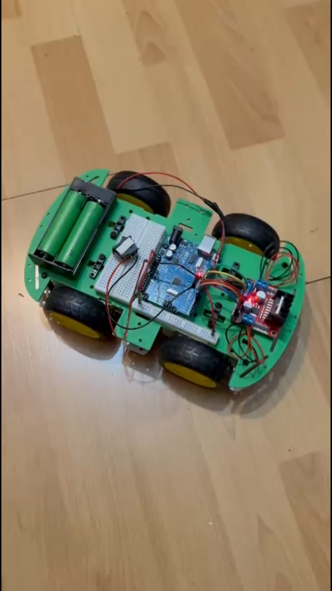
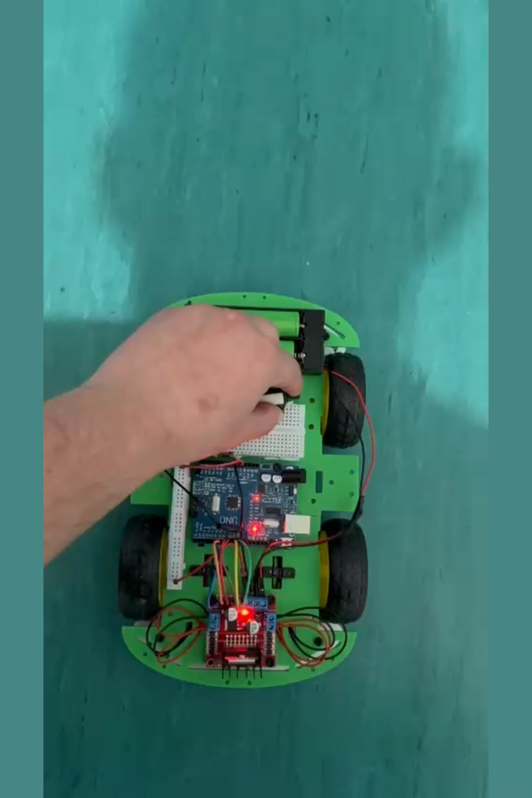
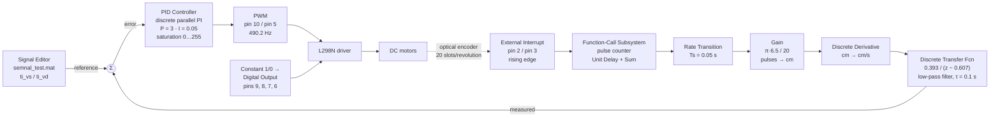

# Robot Car — Closed-Loop Wheel Speed Control with Simulink and Arduino

**Course project — Mobile Robotics**
Transilvania University of Brașov · Faculty of Electrical Engineering and Computer Science

A four-wheel robot car in which the speed of each side is regulated in closed loop by an
independent **discrete PI controller**, designed through *model-based design* in Simulink and run
directly on an **Arduino Uno** via automatic C code generation with Embedded Coder. Speed feedback
comes from slotted optical encoders, read through external interrupts.

| | |
|---|---|
| **Students** | Ștefan Horia-Eusebiu · Ursoiu Cristian |
| **Software** | MATLAB / Simulink R2024b, Embedded Coder, Simulink Support Package for Arduino Hardware |
| **Target** | Arduino Uno (ATmega328P), C code generated with `ert.tlc`, C89/C90 standard |
| **Period** | May 2026 |

> 🇷🇴 Documentul în limba română: [README.ro.md](README.ro.md)

<p align="center">
  
  
</p>

**Video demos:** [start-up and acceleration](media/demo-pornire.mp4) ·
[driving along a path](media/demo-deplasare.mp4)

---

## 1. System architecture

The model contains **two identical, independent control channels**, one per motor (left / right),
plus the direction-control logic.



### The speed measurement loop

The most interesting part of the model is how speed is obtained from a very simple encoder, without
a dedicated encoder-reading block:

1. **Interrupt-driven counting** — the *External Interrupt* blocks (pins 2 and 3, rising edge) each
   trigger a *Function-Call Subsystem*. Each subsystem is a minimal accumulator
   (`Constant` + `Sum` + `Unit Delay`) that increments a counter on every pulse. It runs
   asynchronously, in interrupt context.
2. **Crossing into the periodic domain** — a *Rate Transition* block moves the counter from the
   asynchronous task into the 0.05 s periodic task, with data integrity guaranteed.
3. **Conversion to distance** — `Gain = (π · 6.5) / 20 ≈ 1.021 cm/pulse`, i.e. the circumference of
   the **⌀65 mm** wheel divided by the **20 slots** of the encoder disc.
4. **Differentiation** — a *Discrete Derivative* turns accumulated distance into speed [cm/s].
5. **Filtering** — the discrete transfer function `0.393 / (z − 0.607)` is a first-order low-pass
   filter with unity DC gain (`0.393 / (1 − 0.607) = 1`) and a time constant of `τ = 0.1 s`
   (`e^(−0.05/0.1) = 0.6065`). It smooths the quantisation noise inherent to an encoder with only
   20 pulses per revolution.

### The controller

| Parameter | Value |
|---|---|
| Type | PI, parallel form, discrete time |
| `P` | 3 |
| `I` | 0.05 |
| Integration method | Forward Euler |
| Output saturation | 0 … 255 (the 8-bit PWM duty-cycle range) |
| Anti-windup | clamping |
| Sample time | inherited, 0.05 s |

> The model still stores the values `D = 0.01` and `N = 100`, but the derivative component is
> **disabled** (the block is configured as PI), so it has no effect on the command.

---

## 2. Arduino Uno pin assignment

| Pin | Function | Simulink block |
|---|---|---|
| **2** | Encoder pulse input (external interrupt, rising edge) | `External Interrupt1` |
| **3** | Encoder pulse input (external interrupt, rising edge) | `External Interrupt` |
| **5** | Motor PWM — ENB, 490.2 Hz | `PWM1` |
| **6** | Motor direction — IN4, constant `0` | `Digital Output3` |
| **7** | Motor direction — IN3, constant `1` | `Digital Output2` |
| **8** | Motor direction — IN2, constant `0` | `Digital Output1` |
| **9** | Motor direction — IN1, constant `1` | `Digital Output` |
| **10** | Motor PWM — ENA, 490.2 Hz | `PWM` |

The pairs `(9, 8)` and `(7, 6)` are fixed to the *HIGH / LOW* combination, so both motors are
permanently driven **forward**; control acts exclusively through the PWM duty cycle.

---

## 3. Hardware

| Component | Role |
|---|---|
| Arduino Uno (ATmega328P) | Compute unit — runs the C code generated from Simulink |
| 4WD chassis with 4 geared DC motors | Propulsion |
| L298N motor driver (dual H-bridge) | Power stage: ENA/ENB for PWM, IN1…IN4 for direction |
| Slotted optical encoders (20 slots/revolution) | Wheel speed measurement |
| ⌀65 mm wheels | — |
| 2 × 18650 cells + holder | Power supply |
| Breadboard and wiring | Interconnection |

---

## 4. Execution configuration

| | |
|---|---|
| Solver | fixed-step, discrete |
| Fundamental step | **0.05 s** (20 Hz) |
| Simulation time | 20 s |
| Target board | Arduino Uno |
| System target file | `ert.tlc` (Embedded Coder) |
| Generated language | C, C89/C90 standard |
| Manufacturer / device | Atmel → AVR |
| External mode | disabled — the model runs **standalone** on the board once flashed |

The model has two execution rates: the periodic task `D1` at 0.05 s, and the asynchronous
subsystems triggered by the encoder interrupts.

---

## 5. Reference signals

The *Signal Editor* block loads the commanded speed profiles from
[`model/semnal_test.mat`](model/semnal_test.mat), with **`Scenario2`** active. It carries two
signals: `ti_vs` (left wheel) and `ti_vd` (right wheel), sampled at 0.05 s, without interpolation.
Once the profile is exhausted, the output is driven to zero.

Having two separate references allows both straight-line motion (`ti_vs = ti_vd`) and turning
through a speed difference between the two sides.

---

## 6. Repository structure

```
.
├── model/       Masina.slx (the Simulink model) + semnal_test.mat (reference profiles)
├── firmware/    compiled binary for the Arduino Uno (.hex / .elf / .eep)
├── docs/        project presentation (PPTX, includes the two demo recordings)
└── media/       demo recordings, photographs of the build, model preview
```

Regenerable build directories are not included in the repository — `Masina_ert_rtw/` (the `.o`
object files and the makefile), `slprj/` (the Simulink cache) and `Masina.slxc`. They are recreated
in full the next time the model is built.

---

## 7. How to run

**Requirements:** MATLAB / Simulink R2024b or newer, *Simulink Support Package for Arduino
Hardware*, *Embedded Coder*, *Simulink Coder*, *MATLAB Coder*.

1. Open `model/Masina.slx`.
2. **Re-point the *Signal Editor* block** at the `semnal_test.mat` file in this repository. The path
   saved inside the model is an absolute path from the original machine, so on any other computer
   the block has to be redirected before the model will run.
3. Simulation on the PC: run normally, 20 s, fixed step 0.05 s.
4. Running on the board: **Hardware → Build, Deploy & Start**, with the Arduino Uno connected.

Alternatively, the pre-compiled firmware can be flashed directly, without MATLAB:

```bash
avrdude -c arduino -p atmega328p -P COM3 -b 115200 -U flash:w:firmware/Masina.hex:i
```

```bash
git clone https://github.com/StefanHoria/Masinuta-Robotica-Simulink-Arduino.git
```

---

## License

Academic work published for portfolio purposes. It may be read and cited with attribution to the
authors; it is not intended for commercial reuse or for submission as someone else's own work.
