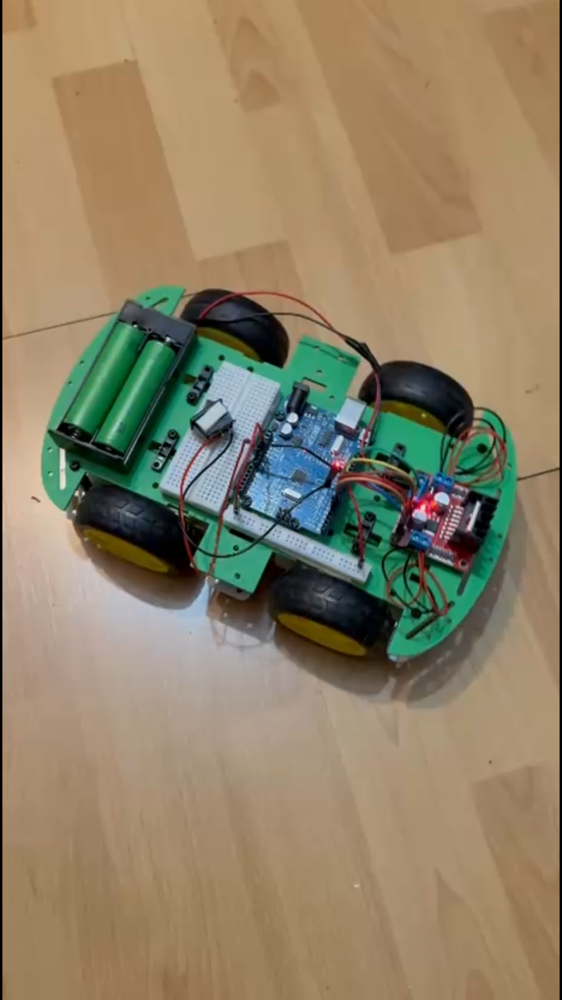
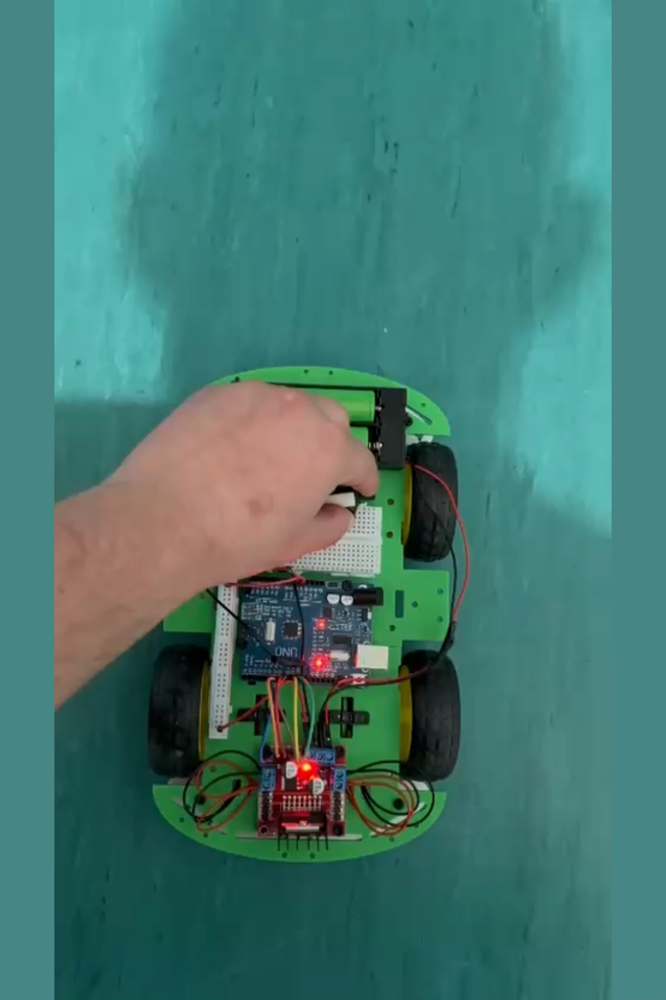
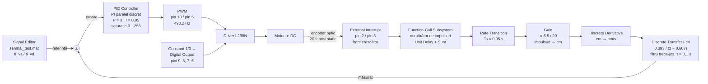

# Mașinuță robotică — reglarea vitezei roților cu Simulink și Arduino

**Proiect la disciplina Robotică Mobilă**
Universitatea Transilvania din Brașov · Facultatea de Inginerie Electrică și Știința Calculatoarelor

Mașinuță robotică cu patru roți, la care viteza fiecărei punți este reglată în buclă închisă de
câte un **regulator PI discret**, proiectat prin *model-based design* în Simulink și rulat direct
pe un **Arduino Uno** prin generare automată de cod C cu Embedded Coder. Feedback-ul de viteză
provine din encodere optice cu fantă, citite prin întreruperi externe.

| | |
|---|---|
| **Studenți** | Ștefan Horia-Eusebiu · Ursoiu Cristian |
| **Software** | MATLAB / Simulink R2024b, Embedded Coder, Simulink Support Package for Arduino Hardware |
| **Țintă** | Arduino Uno (ATmega328P), cod C generat cu `ert.tlc`, standard C89/C90 |
| **Perioadă** | mai 2026 |

> 🇬🇧 English version: [README.md](README.md)

<p align="center">
  
  
</p>

**Demonstrații video:** [pornire și accelerare](media/demo-pornire.mp4) ·
[deplasare pe traseu](media/demo-deplasare.mp4)

---

## 1. Arhitectura sistemului

Modelul conține **două canale de reglare identice și independente**, câte unul pentru fiecare
motor (stânga / dreapta), plus partea de comandă a sensului de rotație.



### Bucla de măsurare a vitezei

Elementul cel mai interesant al modelului este modul în care se obține viteza dintr-un encoder
foarte simplu, fără bloc dedicat de citire a encoderului:

1. **Numărare prin întrerupere** — blocurile *External Interrupt* (pinii 2 și 3, front crescător)
   declanșează câte un *Function-Call Subsystem*. Fiecare subsistem este un acumulator minimal
   (`Constant` + `Sum` + `Unit Delay`) care incrementează un contor la fiecare impuls. Rulează
   asincron, în context de întrerupere.
2. **Trecerea în domeniul periodic** — un bloc *Rate Transition* transferă contorul din task-ul
   asincron în task-ul periodic de 0,05 s, cu integritatea datelor asigurată.
3. **Conversia în distanță** — `Gain = (π · 6,5) / 20 ≈ 1,021 cm/impuls`, adică circumferința
   roții de **⌀65 mm** împărțită la cele **20 de fante** ale discului encoderului.
4. **Derivare** — *Discrete Derivative* transformă distanța cumulată în viteză [cm/s].
5. **Filtrare** — funcția de transfer discretă `0,393 / (z − 0,607)` este un filtru trece-jos de
   ordinul I cu câștig unitar în c.c. (`0,393 / (1 − 0,607) = 1`) și constantă de timp
   `τ = 0,1 s` (`e^(−0,05/0,1) = 0,6065`). Netezește zgomotul de cuantizare inerent unui encoder
   cu doar 20 de impulsuri pe rotație.

### Regulatorul

| Parametru | Valoare |
|---|---|
| Tip | PI, formă paralelă, timp discret |
| `P` | 3 |
| `I` | 0,05 |
| Metoda de integrare | Forward Euler |
| Saturația ieșirii | 0 … 255 (domeniul duty-cycle-ului PWM pe 8 biți) |
| Anti-windup | *clamping* |
| Perioada de eșantionare | moștenită, 0,05 s |

> Modelul păstrează salvate și valorile `D = 0,01` și `N = 100`, dar componenta derivativă este
> **dezactivată** (blocul este configurat ca PI), deci nu are efect asupra comenzii.

---

## 2. Alocarea pinilor Arduino Uno

| Pin | Funcție | Bloc Simulink |
|---|---|---|
| **2** | Intrare încremenire encoder (întrerupere externă, front crescător) | `External Interrupt1` |
| **3** | Intrare încremenire encoder (întrerupere externă, front crescător) | `External Interrupt` |
| **5** | PWM motor — ENB, 490,2 Hz | `PWM1` |
| **6** | Sens motor — IN4, constant `0` | `Digital Output3` |
| **7** | Sens motor — IN3, constant `1` | `Digital Output2` |
| **8** | Sens motor — IN2, constant `0` | `Digital Output1` |
| **9** | Sens motor — IN1, constant `1` | `Digital Output` |
| **10** | PWM motor — ENA, 490,2 Hz | `PWM` |

Perechile `(9, 8)` și `(7, 6)` sunt fixate pe combinația *HIGH / LOW*, deci ambele motoare sunt
comandate permanent în sens **înainte**; reglarea acționează exclusiv prin duty-cycle-ul PWM.

---

## 3. Hardware

| Componentă | Rol |
|---|---|
| Arduino Uno (ATmega328P) | Unitatea de calcul — rulează codul C generat din Simulink |
| Șasiu 4WD cu 4 motoare DC cu reductor | Propulsia |
| Driver de motoare L298N (punte H dublă) | Etajul de putere: ENA/ENB pentru PWM, IN1…IN4 pentru sens |
| Encodere optice cu fantă (20 fante/rotație) | Măsurarea vitezei roților |
| Roți ⌀65 mm | — |
| 2 × acumulatori 18650 + suport | Alimentarea |
| Breadboard și cablaj | Interconectarea |

---

## 4. Configurarea execuției

| | |
|---|---|
| Solver | pas fix, discret |
| Pas fundamental | **0,05 s** (20 Hz) |
| Timp de simulare | 20 s |
| Placă țintă | Arduino Uno |
| System target file | `ert.tlc` (Embedded Coder) |
| Limbaj generat | C, standard C89/C90 |
| Producător / dispozitiv | Atmel → AVR |
| External mode | dezactivat — modelul rulează **autonom** pe placă după programare |

Modelul are două rate de execuție: task-ul periodic `D1` la 0,05 s și subsistemele asincrone
declanșate de întreruperile encoderelor.

---

## 5. Semnalele de referință

Blocul *Signal Editor* încarcă profilurile de viteză impuse din
[`model/semnal_test.mat`](model/semnal_test.mat), scenariul activ fiind **`Scenario2`**, cu două
semnale: `ti_vs` (roata stânga) și `ti_vd` (roata dreapta), eșantionate la 0,05 s, fără
interpolare. După epuizarea profilului, ieșirea este adusă la zero.

Cele două referințe separate permit atât deplasarea rectilinie (`ti_vs = ti_vd`), cât și virajul
prin diferență de viteză între punți.

---

## 6. Structura repository-ului

```
.
├── model/       Masina.slx (modelul Simulink) + semnal_test.mat (profilurile de referință)
├── firmware/    binarul compilat pentru Arduino Uno (.hex / .elf / .eep)
├── docs/        prezentarea proiectului (PPTX, include cele două filmări demonstrative)
└── media/       filmări demonstrative, fotografii ale montajului, previzualizarea modelului
```

Nu au fost incluse în repository directoarele de build regenerabile — `Masina_ert_rtw/`
(fișierele obiect `.o` și makefile-ul), `slprj/` (cache-ul Simulink) și `Masina.slxc`. Se
recreează integral la următoarea compilare a modelului.

---

## 7. Cum se rulează

**Cerințe:** MATLAB / Simulink R2024b sau mai nou, *Simulink Support Package for Arduino Hardware*,
*Embedded Coder*, *Simulink Coder*, *MATLAB Coder*.

1. Deschide `model/Masina.slx`.
2. **Repointează blocul *Signal Editor*** către `semnal_test.mat` din acest repository — vezi
   secțiunea 8, calea salvată în model este cea de pe calculatorul original.
3. Simulare pe PC: rulează normal, 20 s, pas fix 0,05 s.
4. Rulare pe placă: **Hardware → Build, Deploy & Start**, cu Arduino Uno conectat.

Alternativ, firmware-ul deja compilat poate fi programat direct, fără MATLAB:

```bash
avrdude -c arduino -p atmega328p -P COM3 -b 115200 -U flash:w:firmware/Masina.hex:i
```

```bash
git clone https://github.com/StefanHoria/Masinuta-Robotica-Simulink-Arduino.git
```

---


## Licență

Lucrare academică publicată în scop de portofoliu. Poate fi consultată și citată cu indicarea
autorilor; nu este destinată reutilizării comerciale sau depunerii ca lucrare proprie.
